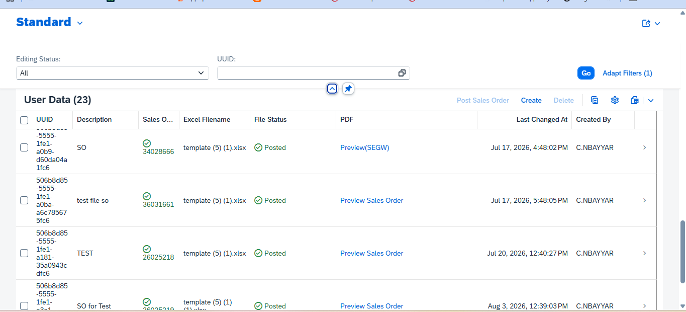
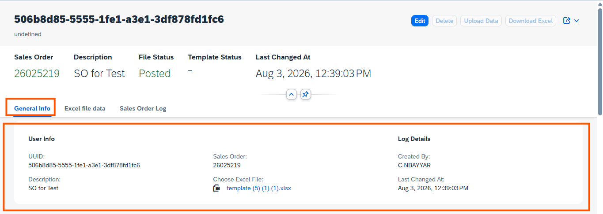
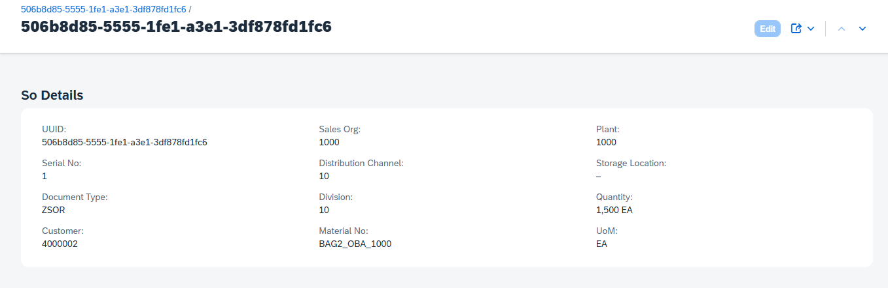
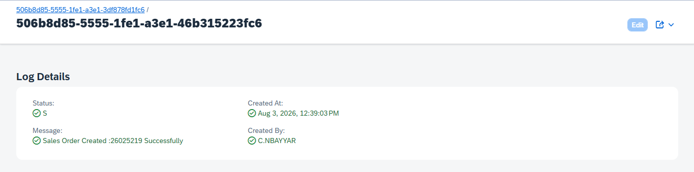
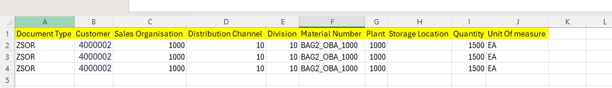

# 📦 Excel Upload & Sales Order Posting with SAP RAP

> **A managed SAP RAP application with draft handling that lets business users upload an Excel file, review sales-order data, post sales orders, and inspect processing logs from a Fiori Elements UI.**

This repository documents the RAP objects included in the supplied project archive. It is written for both business users who want to understand the application flow and SAP developers who want to understand the object model.

---

## Table of Contents

- [Business Purpose](#-business-purpose)
- [Business-User Workflow](#-business-user-workflow)
- [Features](#-features)
- [Architecture at a Glance](#-architecture-at-a-glance)
- [RAP Object Inventory](#-rap-object-inventory)
- [Data Model and Fields](#-data-model-and-fields)
- [Actions and Draft Behavior](#-actions-and-draft-behavior)
- [Status and Criticality](#-status-and-criticality)
- [PDF / Smart Form Integration](#-pdf--smart-form-integration)
- [Screenshots](#-screenshots)
- [Technical Notes and Validation Checklist](#-technical-notes-and-validation-checklist)
- [About the Author](#-about-the-author)

---

## 🎯 Business Purpose

Creating sales orders one by one can be time-consuming when a business needs to process many records. This application provides a guided Fiori Elements experience to:

1. Create an upload record.
2. Select an Excel workbook.
3. upload/read the workbook into a child table for review.
4. Check the imported sales-order header/item input data.
5. Trigger **Post Sales Order**.
6. Review messages written to the sales-order log.
7. See the resulting SAP sales order number and its status.

The supplied objects show a **RAP managed business object with draft support**. Draft data is kept in dedicated draft tables while the user is working, and the RAP draft lifecycle actions support editing, resuming, preparing, activating, and discarding a draft.

> **Important implementation note:** The archive contains the behavior definitions and supporting types for `PostSO`, `uploadExcelData`, and `DownloadExcel`, but the local behavior implementation class file is empty in the supplied export. Therefore, this README explains the intended UI/business behavior and the declared RAP contract; it does not claim to verify the missing action implementation or the exact sales-order posting API used at runtime.

## 👤 Business-User Workflow

### 1. Create an upload record

The user creates a new record in the main list. The root object is exposed to the UI as **User** and is backed by `ZSDT_FILE_TABLE`. A UUID identifies the upload session.

### 2. Select an Excel workbook

The `attachment` field stores the file content, while `filename` and `mimetype` describe the selected file. The CDS large-object annotation accepts Excel MIME types for `.xls` and `.xlsx` files.

The `FillSelectedStatus` determination is declared for changes to `attachment`; the CDS/UI model includes statuses such as **File Selected**.

### 3. Upload/read Excel data

The **Upload Data** action is declared as `uploadExcelData`. The root behavior definition includes a side effect so the UI can refresh the root and child `_UserSo` data after this action. The child entity represents the imported sales-order rows.

The metadata labels the child collection **Excel file data**. Users can review document type, customer, sales area, material, plant, storage location, quantity, and unit of measure.

### 4. Review and post

The **Post Sales Order** action is declared as `PostSO` and appears in the list report and object page. The metadata requests isolated invocation grouping for the list action. After posting, the root model has fields for the resulting sales order (`vbeln`), file status, and log collection.

### 5. Review processing logs

The **Sales Order Log** collection exposes message type, message text, and creation information. The CDS view derives a criticality value from the message type so the UI can visually distinguish errors and successful messages.

### 6. Download the Excel template

The **Download Excel** action is declared as `DownloadExcel`. The supplied behavior contract confirms the action exists, but the exported archive does not include its implementation body, so the exact template-generation/download logic cannot be confirmed from these files alone.

---

## ✨ Features

- **Managed RAP BO:** standard create/update/delete handling is managed by the RAP runtime, subject to the behavior definition.
- **Draft support:** root and child draft tables support work-in-progress editing.
- **Excel attachment:** large-object semantics identify the attachment as a downloadable/uploadable Excel file.
- **Excel child rows:** imported rows are modeled as a composition under the upload root.
- **Post action:** `PostSO` is exposed to the UI as **Post Sales Order**.
- **Upload action:** `uploadExcelData` is exposed as **Upload Data**.
- **Template action:** `DownloadExcel` is exposed as **Download Excel**.
- **Processing log:** a composition stores message type and message text.
- **Status criticality:** status fields are mapped to UI criticality values.
- **Sales order result:** `vbeln` represents the generated sales order number.
- **PDF link field:** `ShowPDF` and `LinkToPDF` are included in the root projection and UI metadata.
- **Smart Form PDF endpoint sample:** a separate Gateway `GET_STREAM` code sample calls Smart Form `ZRAP_TEST` and converts OTF output to PDF.

---

## 🏗 Architecture at a Glance

```text
Fiori Elements UI
       |
       v
Service Definition: ZSD_SO_FILE_UPLOAD
       |
       v
Projection BO / Projection CDS
  ZC_FILE_DATA_SO (root: User)
       |-- ZC_FILE_DT_SO (child: UserSo)
       `-- ZC_SO_LOG     (child: SOLog)
       |
       v
Interface BO / Interface CDS
  ZI_FILE_DATA_SO (root)
       |-- ZI_FILE_DT_SO (Excel sales-order rows)
       `-- ZI_SO_LOG     (processing messages)
       |
       v
Persistence Tables
  ZSDT_FILE_TABLE
  ZSDT_SALES_ORD
  ZSDT_SO_LOG

Draft Persistence
  ZSDT_FILE_TAB_D
  ZSDT_SALES_ORD_D
  ZSDT_SO_LOG_D
```

The service definition exposes the projection entities as `User`, `UserSo`, and `SOLog`. A service binding is required in the SAP system to publish the service; a binding object was not present in the supplied text-object inventory.

---

## 🧱 RAP Object Inventory

| Layer | Object | Purpose |
|---|---|---|
| Persistence | `ZSDT_FILE_TABLE` | Stores the upload session, file attachment, status, sales order result, and audit fields. |
| Persistence | `ZSDT_SALES_ORD` | Stores parsed sales-order input rows. |
| Persistence | `ZSDT_SO_LOG` | Stores posting/upload messages. |
| Draft persistence | `ZSDT_FILE_TAB_D` | Draft copy of the upload root, including `%admin` draft administration data. |
| Draft persistence | `ZSDT_SALES_ORD_D` | Draft copy of imported sales-order rows. |
| Draft persistence | `ZSDT_SO_LOG_D` | Draft copy of log rows. |
| Interface CDS | `ZI_FILE_DATA_SO` | Root interface view; defines compositions to sales-order rows and logs and derives status criticality. |
| Interface CDS | `ZI_FILE_DT_SO` | Child interface view for Excel sales-order input rows. |
| Interface CDS | `ZI_SO_LOG` | Child interface view for log messages and audit metadata. |
| Interface behavior | `ZI_FILE_DATA_SO` behavior | Managed implementation, draft, root actions, determinations, side effects, and persistence mapping. |
| Behavior pool | `ZBP_I_FILE_DATA_SO` | Declares reusable types for Excel row parsing and typed sales-order input. The supplied local class export is empty. |
| Projection CDS | `ZC_FILE_DATA_SO` | Root consumption/projection view for the Fiori Elements UI. |
| Projection CDS | `ZC_FILE_DT_SO` | Projection of imported sales-order rows. |
| Projection CDS | `ZC_SO_LOG` | Projection of processing log rows. |
| Projection behavior | `ZC_FILE_DATA_SO` behavior | Exposes allowed operations, root actions, draft actions, and child associations to the projection layer. |
| Metadata extensions | `ZME_FILE_DATA_SO` | UI header, facets, actions, list columns, field groups, and status data points. |
| Metadata extensions | `ZME_FILE_DT_SO` | Labels and list/object-page fields for imported rows. |
| Metadata extensions | `ZME_C_SO_LOG` | Log labels, columns, and message criticality. |
| Service definition | `ZSD_SO_FILE_UPLOAD` | Exposes the projection entities as `User`, `UserSo`, and `SOLog`. |
| Gateway sample | `GET_STREAM_METHOD_CODE.txt` | Sample PDF stream implementation using Smart Form `ZRAP_TEST`. |

> **Naming note:** the actual DDIC table names in the CDS sources are uppercase versions of `zsdt_file_table`, `zsdt_sales_ord`, and `zsdt_so_log`. The project archive uses a few spelling/capitalization variations in labels and fields (for example, `descripition`); preserve those technical names unless you intentionally rename the fields throughout the model.

---

## 🗂 Data Model and Fields

### 1. Root upload entity — `ZI_FILE_DATA_SO` / `ZC_FILE_DATA_SO`

**Business meaning:** one upload session/file record.

| Field | Meaning for the user | Technical purpose |
|---|---|---|
| `uuid` | Upload session ID | Root key; managed numbering in behavior. |
| `vbeln` | Sales order number | Result field populated/used after successful posting. Read-only in the interface behavior. |
| `descripition` | Description | User-entered description; spelling is as implemented in the source. |
| `attachment` | Excel file | Raw large-object content. |
| `mimetype` | File content type | MIME type associated with the attachment. |
| `filename` | Excel filename | Name displayed for the selected file. |
| `file_status` | Upload/posting status | Examples represented in the CDS criticality expression: File not Selected, File Selected, Excel Uploaded, Posted. |
| `template_status` | Template status | CDS criticality expression recognizes Present and Absent. |
| `Criticality` | File-status visual state | Derived from `file_status`. |
| `SalesOrderCriticality` | Sales-order result visual state | Derived from whether `vbeln` is empty. |
| `TemplateCrticality` | Template visual state | Derived from `template_status`; source spelling is retained. |
| `ShowPDF` | PDF display label/value | Exposed to the UI. |
| `LinkToPDF` | PDF URL | Used as the URL target for the `ShowPDF` UI column. |
| `local_created_by` | Created by | RAP audit field. |
| `local_created_at` | Created at | RAP audit timestamp. |
| `local_last_changed_by` | Last changed by | RAP audit field. |
| `local_last_changed_at` | Last changed at (local instance) | Local last-change timestamp/ETag field. |
| `last_changed_at` | Last changed at | Total ETag timestamp used by the root behavior. |
| `_UserSo` | Excel file data | Composition association to child rows. |
| `_SOLog` | Sales Order Log | Composition association to processing logs. |

**File validation configured in CDS:** the large-object annotation declares acceptable MIME types `application/vnd.ms-excel` and `application/vnd.openxmlformats-officedocument.spreadsheetml.sheet`, with attachment content disposition.

### 2. Imported sales-order rows — `ZI_FILE_DT_SO` / `ZC_FILE_DT_SO`

**Business meaning:** one row parsed from the Excel workbook.

| Field | Business meaning |
|---|---|
| `uuid` | Parent upload session ID |
| `serialno` | Row/serial number within the upload |
| `auart` | Sales document type |
| `kunnr` | Customer |
| `vkorg` | Sales organization |
| `vtweg` | Distribution channel |
| `spart` | Division |
| `matnr` | Material |
| `werks` | Plant |
| `lgort` | Storage location |
| `kwmeng` | Order quantity |
| `vrkme` | Sales unit / unit of measure |

The quantity field `kwmeng` is annotated with `vrkme` as its unit-of-measure field. In the behavior definition, `uuid` and `serialno` are read-only for the child entity. The child association points back to its parent upload record.

### 3. Processing log — `ZI_SO_LOG` / `ZC_SO_LOG`

**Business meaning:** messages associated with an upload session.

| Field | Meaning |
|---|---|
| `Uuid` | Parent upload session ID |
| `Itemuuid` | Log-row key |
| `Type` | Message type (for example, `E` for error and `S` for success in the supplied logic) |
| `Msg` | Message text |
| `Msgcr` | Criticality derived from message type |
| `LocalCreatedBy` | User who created the log entry |
| `LocalCreatedAt` | Log creation timestamp |
| `LocalLastChangedBy` | Last user to change the log entry |
| `LocalLastChangedAt` | Local last-change timestamp |
| `LastChangedAt` | Last-change timestamp |
| `_User` | Parent upload association |

The interface CDS maps `Type = 'E'` to criticality `1`, `Type = 'S'` to `3`, and other types to `0`. The metadata extension displays Status, Message, Created At, and Created By.

---

## ⚙️ Actions and Draft Behavior

The actions below are declared in the RAP behavior definitions and exposed by the projection behavior.

| UI label / RAP action | Bound to | Intended user outcome | What the supplied objects confirm |
|---|---|---|---|
| **Upload Data** / `uploadExcelData` | Root `User` | Read the selected workbook and refresh child rows | Action declaration, UI annotation, and side effect are present. Implementation body is not included in the export. |
| **Post Sales Order** / `PostSO` | Root `User` | Process the imported rows and return sales-order result/messages | Action declaration and UI annotation are present; invocation grouping is `#ISOLATED`. Implementation body is not included in the export. |
| **Download Excel** / `DownloadExcel` | Root `User` | Download a template workbook | Action declaration and UI annotation are present. Implementation body is not included in the export. |
| `Activate` | Root draft | Save/activate the draft into active data | Draft action is exposed through projection behavior. |
| `Edit` | Root draft | Start editing an active record as a draft | Draft action is exposed. |
| `Resume` | Root draft | Continue an existing draft | Draft action is exposed. |
| `Discard` | Root draft | Discard draft changes | Draft action is exposed. |
| `Prepare` | Root draft | Run draft preparation/consistency checks | Draft determine action is exposed. |

### Determinations

- **`FillFileStatus`** — declared on modification of `uuid`; its stated purpose/comment is to set an initial file status during creation.
- **`FillSelectedStatus`** — declared on modification of `attachment`; its stated purpose/comment is to update status when a file is selected.

The determination names and triggers are present in the behavior definition. Their implementation code was not included in the supplied archive, so the exact assignments and error handling should be checked in the full behavior pool.

### Side effects

The root behavior declares side effects so a change to `Attachment` affects `file_status`, and `uploadExcelData` affects the root and `_UserSo` child data. This tells the Fiori Elements client which data should be refreshed after the relevant change/action.

### Managed draft model

The root behavior uses `with draft`, a draft table, `lock master total etag last_changed_at`, and `etag master local_last_changed_at`. Child entities use dependent locking and authorization via `_User`. The draft tables include the RAP draft administrative include `%admin`.

---

## 🚦 Status and Criticality

The interface CDS derives UI criticality values from business fields:

| Field / condition | Derived criticality | Meaning in this model |
|---|---:|---|
| `vbeln` is empty | `0` | No sales order number shown yet |
| `vbeln` is not empty | `3` | Sales order number exists |
| `file_status = 'File Selected'` | `2` | File selected |
| `file_status = 'Excel Uploaded'` | `3` | Excel rows uploaded |
| `file_status = 'File not Selected'` | `1` | No file selected |
| `file_status = 'Posted'` | `3` | Posted status |
| `template_status = 'Present'` | `3` | Template present |
| `template_status = 'Absent'` | `1` | Template absent |
| Log `Type = 'E'` | `1` | Error |
| Log `Type = 'S'` | `3` | Success |
| Other log types | `0` | Neutral/default |

These are numeric criticality values used by the UI metadata. The exact color/icon rendering depends on the Fiori Elements client and annotation interpretation.

---

## 🖨️ PDF / Smart Form Integration

The archive also contains a Gateway `GET_STREAM` sample that:

1. Reads a key from `it_key_tab` as a sales order number.
2. Resolves the generated function module for Smart Form `ZRAP_TEST` using `SSF_FUNCTION_MODULE_NAME`.
3. Runs the Smart Form and collects OTF output.
4. Converts OTF to PDF using `CONVERT_OTF`.
5. Returns `application/pdf` content through `er_stream`.
6. Sets a `Content-Disposition` header using a filename such as `SalesOrder_<VBELN>.pdf`.

The root projection contains `ShowPDF` and `LinkToPDF`, and the metadata extension configures `ShowPDF` as a URL-style column using `LinkToPDF`.

**Integration boundary:** this PDF sample is a separate Gateway/SAP Smart Form implementation. The supplied files do not prove that the RAP `PostSO` action calls it, nor that `LinkToPDF` is populated automatically. Confirm the URL construction, service registration, authorization, and generated PDF behavior in the target SAP system.

---

## 🖼️ Screenshots

The archive includes UI screenshots in `Application_UI/`. Keep these files in that folder in your repository and use the relative links below.

| Screenshot | What it should help demonstrate |
|---|---|
| `Main_Page.png` | Main list/report page |
| `Object_Page1.png` | Main upload record object page |
| `Object_page2.png` | Additional object-page section |
| `Object_Page3.png` | Additional object-page section |
| `Item_Object_Page.png` | Imported Excel row details |
| `SO_LOG_Object_Page.png` | Sales-order processing logs |
| `Upload_file_format.png` | Expected workbook/file format |

### Main page



### Upload record object page



### Excel row details



### Sales order logs



### Expected Excel format



---

## 🔍 Technical Notes and Validation Checklist

Before using this project as a production template, validate the following in the target system:

- [ ] Include the complete behavior pool implementation for `PostSO`, `uploadExcelData`, `DownloadExcel`, `FillFileStatus`, and `FillSelectedStatus`.
- [ ] Confirm workbook parsing, column order/header handling, empty rows, invalid values, duplicate rows, and numeric/date conversion.
- [ ] Validate required sales-order fields and master data before posting.
- [ ] Confirm the chosen sales-order creation API, commit/rollback handling, and transaction boundaries in `PostSO`.
- [ ] Persist success/error messages consistently in `ZSDT_SO_LOG` and show useful user-facing messages.
- [ ] Confirm whether one failed row should stop the complete upload or allow other rows to proceed.
- [ ] Test draft create/edit/resume/discard/activate behavior for root and child entities.
- [ ] Check authorization implementation. The interface root declares `authorization master ( global )`, while the CDS views shown use `@AccessControl.authorizationCheck: #NOT_REQUIRED`; align these settings with the intended security model.
- [ ] Confirm the service binding type and publish/activate the service in the target system.
- [ ] Check the PDF URL, Gateway service, Smart Form activation, output authorization, and filename handling.
- [ ] Test large files and payload limits; `attachment` is modeled as a raw string large object.
- [ ] Check naming consistency and correct typos only as a coordinated model change (CDS, behavior mapping, metadata, persistence, and UI).

### Suggested end-to-end test

1. Create a new upload record.
2. Enter a description and select a valid `.xls` or `.xlsx` file.
3. Save/activate or continue the draft according to the UI flow.
4. Choose **Upload Data** and verify child rows appear.
5. Test invalid customer/material/quantity values and verify understandable messages.
6. Choose **Post Sales Order** and verify the generated `vbeln` (if successful).
7. Open **Sales Order Log** and verify success/error messages.
8. Test **Download Excel** and confirm the file opens with the expected columns.
9. Test draft resume and discard.
10. If PDF is configured, open the PDF link and verify the correct sales order is rendered.

---

## 👋 About the Author

# Nepal Singh Rajputh

### SAP ABAP Consultant | RAP • S/4HANA • CDS • AMDP • OData • APIs • Integrations

> **I turn SAP business requirements into maintainable, user-focused applications—connecting proven ABAP engineering with modern RAP, CDS, Fiori Elements, and S/4HANA architecture.**

I’m an **SAP ABAP Consultant with 5+ years of experience**, working across SAP development, enhancements, integrations, reporting, and business-process solutions. My current learning and delivery focus is on **modern S/4HANA development, RAP, Clean Core, extensibility, performance optimization, and API-driven architecture**.

### What I work with

- **RAP:** Managed and unmanaged business objects, draft-enabled applications, actions, determinations, validations, and side effects
- **Data modeling:** CDS Views, associations, annotations, and AMDP
- **User experience:** Fiori Elements and OData services
- **Integration:** REST APIs, proxies, SAP Build Workflows, and service integrations
- **Core ABAP:** Modern ABAP syntax, DDIC, reports, ALV, Module Pool, BDC, BAPIs, and enhancements
- **Forms & output:** Adobe Forms and Smart Forms
- **Business processes:** SAP SD, MM, FI, and PP
- **Engineering focus:** Performance optimization, Clean Core, extensibility, and maintainable solutions
- **Cloud journey:** Exploring SAP BTP and modern SAP architecture

### My development philosophy

I believe strong SAP solutions come from combining **solid ABAP fundamentals, clear business understanding, thoughtful data modeling, and clean user experiences**. I enjoy learning modern SAP capabilities and turning that knowledge into practical applications that are useful to real business users.

**Thanks for visiting this repository.** If you find it useful, feel free to explore the objects, learn from the model, and share suggestions.

---

## 🏷️ Suggested Repository Topics

`sap-abap` `sap-rap` `abap-restful-application-programming-model` `s4hana` `cds-views` `fiori-elements` `excel-upload` `sales-order` `draft-enabled` `odata` `sap-btp`

